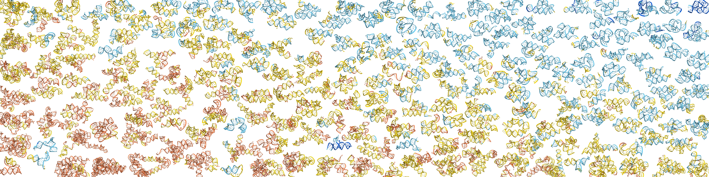

# OpenFold3 structures for Rfam seed alignments

[OpenFold3](https://github.com/aqlaboratory/openfold-3) structures, MSAs and [RNAView](https://github.com/rcsb/RNAView/tree/6349bbd94584baecf54161f40206308471be665c) base pairs for every unique sequence in the [Rfam](https://rfam.org) 15.1 seed alignments.

> 🪢 **[Browse the structures](https://marcellszi.github.io/rfam-seed-openfold3/)** in 3D, with plDDT, base pairs and PDB overlays.\
> 🤗 **[Hugging Face dataset](https://huggingface.co/datasets/marcellszikszai/rfam-seed-openfold3)** with every structure, MSA and metadata.

Site for *Narrowing the RNA sequence-structure gap: OpenFold3 models for all Rfam RNA structural families* (coming soon).

## Citation

Coming soon.

Please also cite:

- Rfam: [Rfam 15: RNA families database in 2025](https://doi.org/10.1093/nar/gkae1023) (Nucleic Acids Research, 2025)
- OpenFold3: [OpenFold3-preview v0.5.0](https://doi.org/10.5281/zenodo.22042719) (Zenodo, 2026)
- AlphaFold3: [Accurate structure prediction of biomolecular interactions with AlphaFold 3](https://doi.org/10.1038/s41586-024-07487-w) (Nature, 2024)
- RNAView: [Tools for the automatic identification and classification of RNA base pairs](https://doi.org/10.1093/nar/gkg529) (Nucleic Acids Research, 2003)
